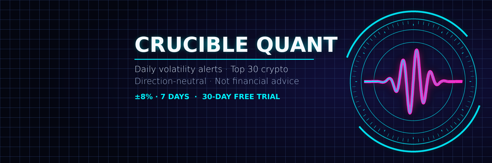
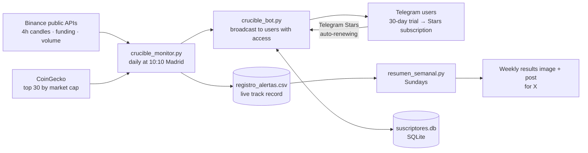

<p align="center">
  
</p>

# Crucible Quant

**A statistically validated crypto volatility-alert system, running in production as a paid Telegram service.**

Every day, Crucible Quant scans the top 30 cryptocurrencies by market cap and flags the coins that are statistically likely to move **±8% within the next 7 days**. It does not predict direction. It tells you *when* a large move is likely, which is risk information traders can actually use: when to avoid tight stops or high leverage, how to size positions, and where the action is likely to be this week.

The project started as an attempt to predict price direction. Rigorous out-of-sample testing showed that direction was not reliably predictable from the data available. Volatility was. The research that got there is documented in [`docs/RESEARCH.md`](docs/RESEARCH.md), including everything that failed.

> 🤖 Live bot: [@CrucibleQuantBot](https://t.me/CrucibleQuantBot) · 30-day free trial
> 📊 Weekly live results: [@cruciblequant on X](https://x.com/cruciblequant)

---

## Key results

Most recent period, **2025–2026**:

| Alert type | Moved ±8% within 7 days | Usual rate | Edge |
|---|---|---|---|
| 🔴 **Double alert** (2+ signals at once) | **88.8%** | 75.8% | **+13 pts** |

Validated edges by signal (probability points above each coin's own base rate):

| Signal | What it captures | Edge |
|---|---|---|
| Volatility spike | Short-term volatility far above its 90-day level (volatility clusters) | **+12.7 pts** |
| Volume surge | Trading volume far above its recent average | **+11.5 pts** |
| Rally + pullback | Strong prior rally followed by a correction | +7.1 pts |
| Extreme funding | Perpetual funding in the extreme tail of its last year | +7.0 pts |
| Best pairs | e.g. volatility spike + volume surge | up to **+16 pts** |

Every signal had to hold **year after year since 2020**, across 30 coins, with bootstrap confidence intervals entirely above zero.

**Live track record:** every alert is logged and automatically checked 7 days later; the real hit rate is shown in every daily summary and published weekly on X, misses included. Live tracking started on 30 Sep 2026.

> Past and backtested results do not guarantee future results. This is risk information, not financial advice.

---

## What it does in production



- **Signal engine** (`crucible_monitor.py`): downloads fresh market data, computes the four validated signals for each coin, estimates the move probability (coin base rate + validated edge) and writes a live log.
- **Subscription bot** (`crucible_bot.py`): Telegram bot with a 30-day free trial, **auto-renewing monthly subscriptions paid in Telegram Stars**, trial reminders, `/status`, `/cancel`, admin `/stats`, and broadcast of the daily summary to every user with access.
- **Live track record**: each alert is re-checked after 7 days against what actually happened (`SI`/`NO`).
- **Weekly report** (`resumen_semanal.py`): generates a results image and an X-ready post (≤280 chars) using **closed alerts only**, so the paid product is never given away.
- **Deployment** (`servidor/instalar.sh`): one-command install on an Ubuntu VPS (Oracle Cloud Free Tier): systemd service for the bot, cron jobs for the daily monitor and weekly report, Madrid timezone with automatic DST.
- **Growth**: Telegram's native affiliate program (commission-based partnerships).

Example of a daily summary sent to subscribers:

```
🚨 CRUCIBLE · 30/09/2026 15:55
Candle closed at 14:00 CEST (12:00 UTC)

LIKELY ±8% MOVE WITHIN 7 DAYS (direction unknown):
🔴 SUI 1.1501 · 93% (usual 80%)
    rally + pullback, volatility spike
🔴 LINK 14.428 · 84% (usual 70%)
    rally + pullback, volatility spike
🟠 AVAX 11.137 · 83% (usual 70%)
    volatility spike
...
No alert: BTC, ETH, BNB, XRP, SOL, ...

📊 Live: 17 alerts logged, none closed yet (they take 7 days)
```

---

## Methodology

**Data** (all public, no API keys): Binance perpetual futures 4h candles (base series), Binance spot candles where available, Binance funding rate history (normalised to an 8h equivalent across 1h/4h/8h funding intervals), CoinGecko market-cap ranking. Contracts such as `1000PEPEUSDT` are rescaled.

**Target:** does price touch +8% **or** −8% within the next 42 four-hour candles (7 days)?

**Validation protocol** (`senales_volatilidad.py`):
1. **Simple, a-priori thresholds:** round-number cut-offs fixed before testing, not optimised on the data (no curve fitting).
2. **Year-by-year consistency:** the edge must be positive in at least 60% of the years 2020–2026, not just on average. Directional research used a strict time split (2020–2024 design, 2025–2026 confirmation).
3. **Non-overlapping episodes:** at most one measurement per coin every 7 days, so consecutive candles do not inflate the sample.
4. **Per-coin, per-year base rates:** the edge is measured against the same coin in the same year, so high-volatility coins cannot fake an effect.
5. **Bootstrap confidence intervals** (2,000 resamples). A signal is approved only if the whole 95% CI is above zero, the edge is positive in at least 60% of years, and n ≥ 100.
6. **Pre-registered criteria and multiple-testing awareness:** pass/fail rules were fixed before looking at results; directional experiments used a Bonferroni correction.
7. **Breadth:** tested pooled across 30 coins, not on a single asset.

**Probability shown to users:** `coin base rate + validated edge` (the largest edge among the active signals and pairs), capped at 99%.

---

## Tech stack

Python · pandas · NumPy · REST APIs (Binance, CoinGecko, Telegram Bot API) · Telegram Stars payments (`createInvoiceLink` with `subscription_period`) · SQLite · Pillow (report images) · Linux, systemd and cron (deployment) · Windows Task Scheduler (local) · SQL for on-chain research (Google BigQuery, Dune).

---

## Repository structure

```
crucible-quant/
├── crucible_monitor.py       # Daily signal engine + live track record + broadcast
├── crucible_bot.py           # Telegram subscription bot (trial, Stars payments, commands)
├── resumen_semanal.py        # Weekly results image + X post (closed alerts only)
├── senales_volatilidad.py    # Validation of volatility signals (bootstrap, per-year checks)
├── uni_datos.py              # Data layer: Binance/CoinGecko download, feature engineering
├── params.py                 # Loads private parameters, or public placeholders
├── parametros_ejemplo.py     # PUBLIC placeholder thresholds (see note below)
├── configurar_telegram.py    # One-time Telegram setup
├── config_telegram.example.json
├── telegram/                 # Public bot texts (README, disclaimer, privacy, pricing), branding scripts
├── servidor/instalar.sh      # One-command VPS deployment (systemd + cron)
├── windows/                  # Local launchers (Task Scheduler)
├── research/                 # Every experiment, including the ones that failed
│   ├── results/              # Raw outputs of key experiments
│   └── onchain/              # BigQuery / Dune SQL for exchange-flow research
├── docs/RESEARCH.md          # The research journey: what worked, what did not and why
└── assets/                   # Branding
```

### A note on the parameters

Crucible Quant is a live, paid product, so the **exact production thresholds and fitted edges are kept in a private `parametros.py`** that is not published. The public `parametros_ejemplo.py` contains placeholder values: all the code runs end-to-end with them, but they are not the validated production values. The methodology, the code and the validation framework are fully public.

---

## Running it

```bash
pip install -r requirements.txt

# 1. Telegram setup (creates config_telegram.json; never commit it)
python configurar_telegram.py

# 2. Daily monitor (≈3 min: downloads 400 days × 30 coins)
python crucible_monitor.py

# 3. Subscription bot (long-running)
python crucible_bot.py

# 4. Weekly report (prints only, does not send)
python resumen_semanal.py --no-enviar

# Server deployment (Ubuntu): copy the folder + private files, then
bash servidor/instalar.sh
```

---

## Limitations

- **Direction is not predicted.** The alerts say a large move is likely, not which way.
- **The base rate is already high.** Crypto moves ±8% in a week often; the value is the *edge over each coin's usual rate*, not the headline percentage.
- **Survivorship bias:** the universe is today's top 30.
- **Two market regimes** (2020–24, 2025–26) is a limited basis for claims about all future regimes. That is why the live track record is public.
- **Not financial advice.**

---

## Author

**Ivan Alonso** · Barcelona, Spain
Data science and blockchain. Founder of BCSentinel AI, an on-chain intelligence platform for Ethereum.

[GitHub](https://github.com/ivanalonso-dev) · [X / Crucible Quant](https://x.com/cruciblequant) · ivanalonso.dev@gmail.com

<sub>Code comments and variable names are in Spanish; documentation is in English.</sub>
